# Color Harmonization

A C++ desktop application exploring color harmonization through hue templates, spatial coherence, and interactive visualization. The project is inspired by Cohen-Or et al.'s SIGGRAPH 2006 paper, [Color Harmonization](https://www.cs.tau.ac.il/~dcor/articles/2006/Color-Harmonization.pdf).

Given an image, the application analyzes its hue distribution, selects a harmonic template, and shifts hues toward the template. A Qt Widgets interface makes it possible to compare the original and processed images, inspect their hue histograms, and experiment with different settings.

> This is a learning-oriented implementation inspired by the paper. It also includes simpler mapping methods for comparison and does not claim to reproduce every detail of the original algorithm.

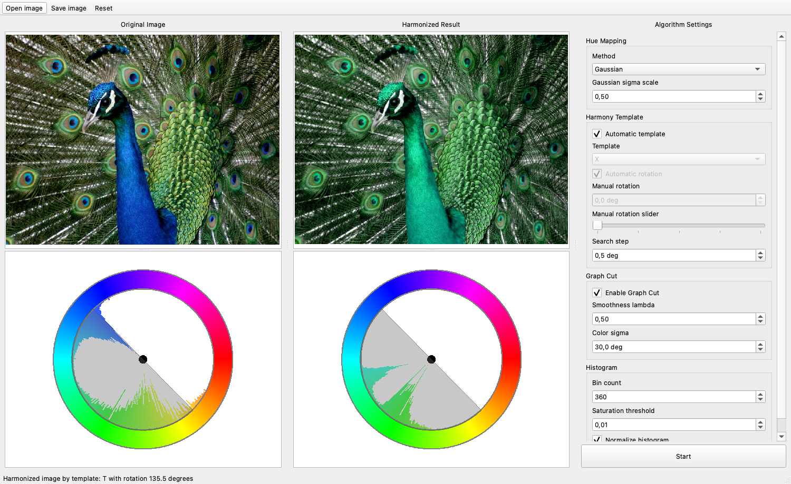

## Results

### Automatic Template Matching

| Original | Nearest center | Linear | Gaussian |
| --- | --- | --- | --- |
| 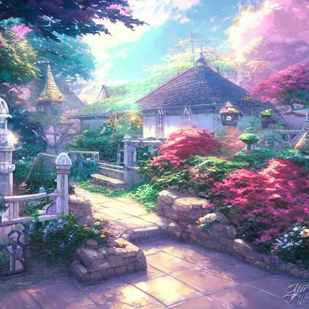 | 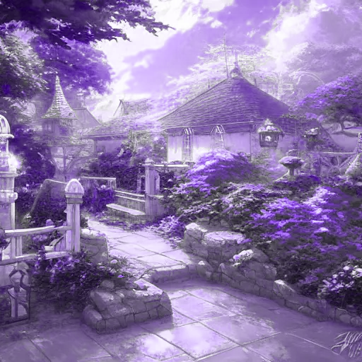 | 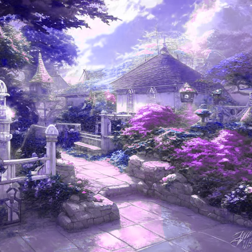 | 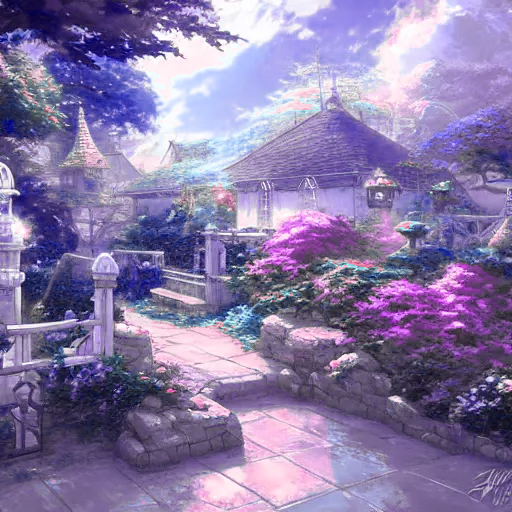 |
| 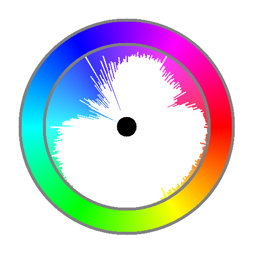 | 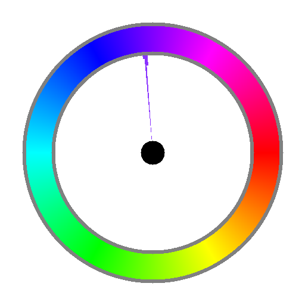 | 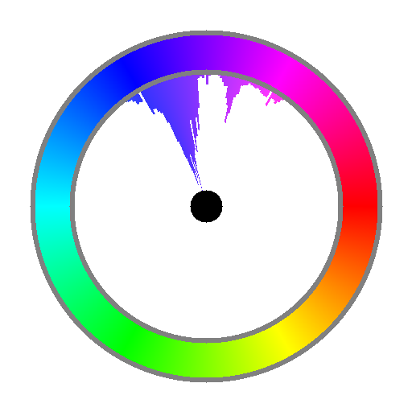 | 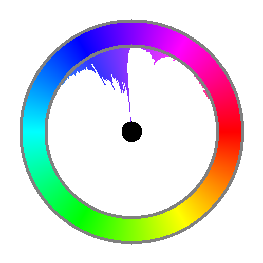 |

The first row shows the images; the second row shows the hue histogram calculated from each corresponding image. Each histogram is normalized independently.

For each method, the application automatically selected the **T** template at **265.5°**. All three runs used graph cut (lambda 0.5, color sigma 30°); the Gaussian run used a sigma scale of 0.5. The current graph-cut linear mapping scales distance differently from the non-graph-cut linear mapping, so this comparison reflects the current implementation.

Source: [Fantastic background illustration created by Stable Diffusion](https://commons.wikimedia.org/wiki/File:Fantastic_background_illustration_created_by_Stable_Diffusion.webp), labeled [CC0 1.0](https://creativecommons.org/publicdomain/zero/1.0/) on Wikimedia Commons. The input was converted from WebP to PNG; the results were recolored by this project.

### Graph Cut Comparison

Both results use the same peacock image, Gaussian mapping (sigma scale 0.5), and a manually selected **I** template at **129°**. The graph-cut result uses lambda 2 and color sigma 10°. In this example, graph cut reduces the green and purple split along the neck. Other regions can still change or develop artifacts; the effect depends on the image and parameters.

| Without graph cut | With graph cut |
| --- | --- |
| [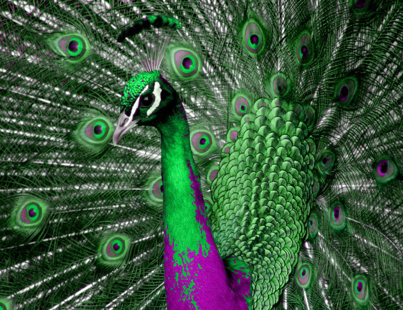](assets/readme/peacock-i129-no-cut.png) | [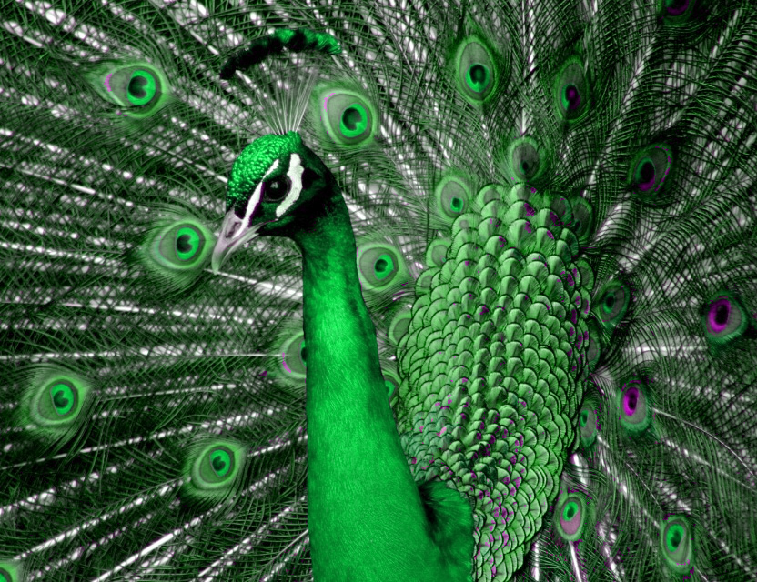](assets/readme/peacock-i129-graph-cut.png) |

[View the original image](assets/input/bird.jpg). Both comparison images use the same 832 × 640 resolution; click either result to view it at full size.

These images are saved examples. Results depend on the input image, selected template, rotation, and mapping parameters.

## Features

- RGB and HSV image representations with custom `Image` and pixel types.
- Hue histograms with configurable bin count and saturation threshold for template matching.
- Automatic template and rotation search, or manual template and rotation selection.
- Three hue-mapping approaches: nearest sector center, linear, and Gaussian.
- Optional graph-cut-based direction assignment to encourage spatial coherence.
- Side-by-side image and circular hue-histogram views, with a template overlay and manual rotation preview.
- Qt interface for opening images, adjusting parameters, running harmonization, and saving results.

## How It Works

1. Convert the input image from RGB to HSV and build a weighted hue histogram.
2. Compare the histogram against harmonic templates at different rotations. Hues outside a template contribute a distance-based cost.
3. Select a template automatically or use the user's manual selection.
4. Optionally use graph cut to assign hue-movement directions, then apply the selected mapping method.
5. Convert the result back to RGB and display it alongside its hue histogram.

The algorithm changes hue; it is not intended to match illumination or exposure between images.

## Build and Run

Requirements:

- A C++17 compiler
- CMake 3.22 or newer
- Qt 6 Widgets

The stb headers and maxflow source used by the project are included in `third_party/`. CMake must be able to find your Qt installation. For example, on macOS with Homebrew Qt:

```sh
cmake -S . -B build -DCMAKE_PREFIX_PATH="$(brew --prefix qt)"
cmake --build build --target color_harmonizer_gui
./build/color_harmonizer_gui
```

For another Qt installation, set `CMAKE_PREFIX_PATH` to its installation prefix. On multi-configuration generators, the executable may be inside a configuration directory such as `build/Debug/`.

In the application, open a PNG or JPEG image, choose the mapping and template settings, and select **Start**. Disable both automatic template and automatic rotation to preview a manually selected template and rotation. Use **Save image** to export the result.

The GUI target is the supported entry point for this version. `app/cli_main.cpp` is an experimental hard-coded example and currently refers to an older graph-cut API, so a default build that includes the CLI target may fail.

## Project Structure

```text
app/gui/                       Qt Widgets interface
app/cli_main.cpp               Experimental command-line example
include/color_harmonization/   Public core interfaces
src/color_harmonization/       Image processing and harmonization
third_party/                   stb and maxflow
assets/                        Example inputs and outputs
```

## Dependencies and Attribution

- [Qt 6](https://www.qt.io/): desktop interface.
- [stb](https://github.com/nothings/stb): image loading and writing in the core library.
- [maxflow v3.04](third_party/maxflow-v3.04/README.TXT): graph-cut optimization. See its included license and usage terms before redistributing this project.

Daniel Cohen-Or, Olga Sorkine, Ran Gal, Tommer Leyvand, and Ying-Qing Xu. **Color Harmonization.** ACM Transactions on Graphics, 25(3), 624–630, 2006. [Paper](https://www.cs.tau.ac.il/~dcor/articles/2006/Color-Harmonization.pdf) · [DOI](https://doi.org/10.1145/1141911.1141933)

## Future Work

- Foreground/background masks and region-based harmonization.
- AI-assisted segmentation and interactive mask refinement.
- Automated tests and further evaluation of graph-cut behavior.
- Improved responsiveness for computationally expensive operations.
